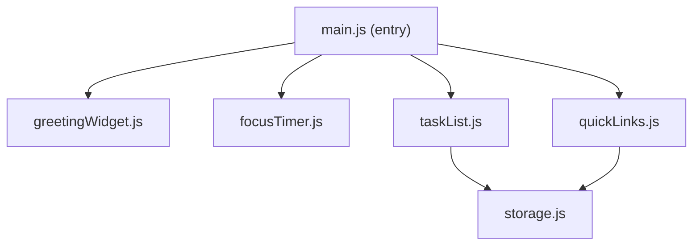
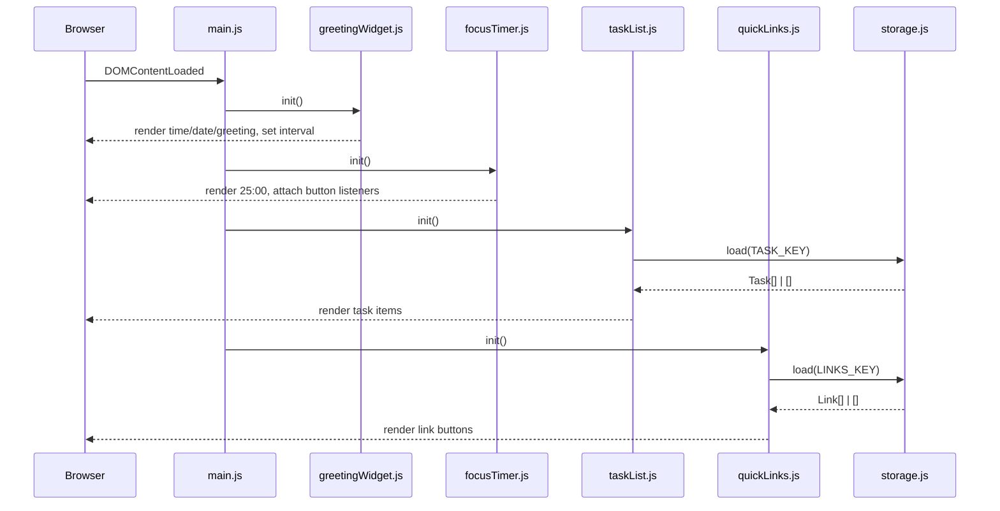
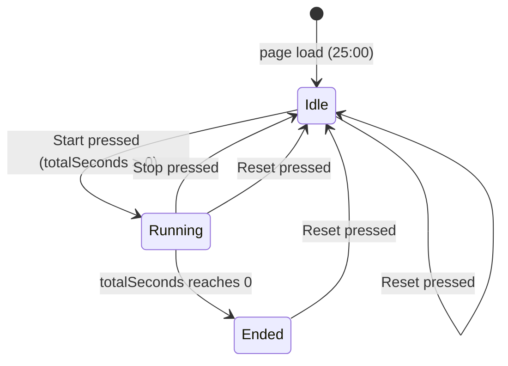

# Design Document

## Overview

The To-Do List Life Dashboard is a single-page client-side web application delivered as three files: one HTML document, one CSS stylesheet, and one JavaScript module. It combines four independent widgets — a live Greeting Widget, a Pomodoro-style Focus Timer, a Task List, and a Quick Links launcher — into a cohesive personal productivity hub.

All state is persisted exclusively in the browser's `localStorage` API. There is no backend, no build step, and no external framework dependency. The application works by opening `index.html` directly in a browser or by bundling it as a browser extension.

### Design Goals

- **Zero dependencies** — only the browser platform (HTML5, CSS3, ES2020 Vanilla JS).
- **Module-first JS** — each widget is an isolated ES module with a narrow public interface, preventing global-scope pollution.
- **Graceful degradation** — every widget handles its own error states; a failure in one widget never crashes another.
- **Single source of truth** — `localStorage` is the only persistence layer; the in-memory state is always a direct reflection of what is stored.

---

## Architecture

The application is structured as a thin coordinator (`main.js`) that bootstraps four self-contained widget modules at page load. Each widget module owns its DOM subtree, its LocalStorage key, and its runtime state object. Widgets communicate only through the shared persistence layer and do not call each other's APIs directly.

```
index.html
├── css/
│   └── styles.css          ← all layout, theming, and widget styling
└── js/
    ├── main.js             ← entry point; imports and initialises all widgets
    ├── greetingWidget.js   ← Greeting Widget module
    ├── focusTimer.js       ← Focus Timer module
    ├── taskList.js         ← Task List module
    ├── quickLinks.js       ← Quick Links module
    └── storage.js          ← thin localStorage wrapper with error handling
```

### Module Dependency Graph



`greetingWidget.js` and `focusTimer.js` have no persistence and therefore do not import `storage.js`. Only `taskList.js` and `quickLinks.js` read and write `localStorage` (through the shared `storage.js` wrapper).

### Initialisation Sequence



---

## Components and Interfaces

### `storage.js` — LocalStorage Wrapper

Provides a two-function API used by all persistence-dependent modules. All `localStorage` calls are wrapped in `try/catch` so that a browser with `localStorage` disabled or full does not throw an uncaught exception.

```js
/**
 * Reads and JSON-parses a value from localStorage.
 * Returns `defaultValue` if the key is absent, storage is unavailable,
 * or the stored string cannot be parsed as valid JSON.
 */
function load(key, defaultValue = [])

/**
 * JSON-serialises `value` and writes it to localStorage.
 * Returns `true` on success, `false` on failure (storage unavailable / quota exceeded).
 * Callers are responsible for displaying an error message when `false` is returned.
 */
function save(key, value)
```

Storage keys used across the application:

| Constant | Key string | Owner module |
|---|---|---|
| `TASK_KEY` | `"tld_tasks"` | `taskList.js` |
| `LINKS_KEY` | `"tld_links"` | `quickLinks.js` |

---

### `greetingWidget.js` — Greeting Widget

Owns the `#greeting-widget` DOM section.

**Public interface:**

```js
/** Bootstraps the widget; renders once immediately and starts the 60-second update interval. */
function init()
```

**Internal responsibilities:**

| Function | Description |
|---|---|
| `renderGreeting()` | Reads `new Date()`, formats time/date, picks greeting string, writes to DOM. Falls back to `--:--` if `Date` is invalid. |
| `getGreetingForHour(hour)` | Pure function: maps a 0–23 integer to one of the four greeting strings. |
| `formatTime(date)` | Pure function: returns `HH:MM` string in 24-hour format. |
| `formatDate(date)` | Pure function: returns `"Weekday, DD Month YYYY"` string. |

**Greeting mapping** (from Requirement 1):

| Hours (inclusive) | Greeting |
|---|---|
| 05 – 11 | Good Morning |
| 12 – 17 | Good Afternoon |
| 18 – 20 | Good Evening |
| 21 – 23 | Good Night |
| 00 – 04 | Good Night |

---

### `focusTimer.js` — Focus Timer

Owns the `#focus-timer` DOM section.

**Public interface:**

```js
/** Bootstraps the widget; initialises display to 25:00 and attaches event listeners. */
function init()
```

**Internal state:**

```js
{
  totalSeconds: 1500,   // current remaining seconds (1500 = 25:00)
  intervalId: null,     // setInterval handle; null when stopped
  isRunning: false
}
```

**Internal responsibilities:**

| Function | Description |
|---|---|
| `startTimer()` | No-ops if already running or `totalSeconds === 0`. Sets `isRunning = true`, starts a `setInterval` that calls `tick()` every 1000 ms. |
| `stopTimer()` | Clears the interval, sets `isRunning = false`. |
| `resetTimer()` | Calls `stopTimer()`, sets `totalSeconds = 1500`, re-renders display. |
| `tick()` | Decrements `totalSeconds`. If it reaches 0: clears interval, sets `isRunning = false`, calls `renderEndMessage()`. |
| `renderDisplay()` | Writes `MM:SS` string to the timer display element. |
| `renderEndMessage()` | Makes the session-end message element visible. |
| `formatMMSS(seconds)` | Pure function: converts a seconds integer to a zero-padded `MM:SS` string. |

**Timer state machine:**



---

### `taskList.js` — Task List

Owns the `#task-list` DOM section.

**Public interface:**

```js
/** Loads tasks from localStorage and renders the task list. */
function init()
```

**Internal operations:**

| Function | Description |
|---|---|
| `addTask(description)` | Validates (non-empty, ≤ 250 chars after trim). On success: creates a Task object, appends to the array, persists, re-renders. On failure: shows inline validation message. |
| `editTask(id)` | Puts the task item into edit mode, showing the editable field with save/discard controls. |
| `saveEdit(id, newDescription)` | Validates the new description. On success: updates the task, persists, exits edit mode. On failure: shows inline validation message. |
| `discardEdit(id)` | Exits edit mode for the task, restoring the original description in the DOM. |
| `toggleTask(id)` | Flips the task's `completed` boolean, persists, re-renders the single item. |
| `deleteTask(id)` | Removes the task from the array, persists, removes the DOM element. |
| `persist()` | Calls `storage.save(TASK_KEY, tasks)`. If `save` returns `false`, shows the global storage-error banner. |
| `renderAll()` | Clears the task container and re-renders every task from the in-memory array. |
| `renderTask(task)` | Creates and returns the DOM element for a single task (normal or edit mode). |
| `validateDescription(raw)` | Returns `{ valid: boolean, trimmed: string, error: string }`. |

---

### `quickLinks.js` — Quick Links

Owns the `#quick-links` DOM section.

**Public interface:**

```js
/** Loads links from localStorage and renders link buttons. */
function init()
```

**Internal operations:**

| Function | Description |
|---|---|
| `addLink(label, url)` | Validates label (non-empty, ≤ 200 chars), URL (non-empty, ≤ 2048 chars, starts with `http://` or `https://`), and total count (< 50). On success: appends Link, persists, renders button. On failure: shows appropriate inline validation message. |
| `deleteLink(id)` | Removes the Link from the array, persists, removes the DOM element. |
| `openLink(url)` | Calls `window.open(url, '_blank', 'noopener,noreferrer')`. |
| `persist()` | Calls `storage.save(LINKS_KEY, links)`. If `save` returns `false`, shows the global storage-error banner. |
| `renderAll()` | Clears and re-renders all link buttons from the in-memory array. |
| `renderLink(link)` | Creates and returns the DOM element for a single link button with its delete control. |
| `validateLink(label, url)` | Returns `{ valid: boolean, errors: { label?: string, url?: string } }`. |

---

### `main.js` — Entry Point

```js
import { init as initGreeting } from './greetingWidget.js';
import { init as initTimer }    from './focusTimer.js';
import { init as initTasks }    from './taskList.js';
import { init as initLinks }    from './quickLinks.js';

document.addEventListener('DOMContentLoaded', () => {
  initGreeting();
  initTimer();
  initTasks();
  initLinks();
});
```

---

## Data Models

### Task

```js
/**
 * @typedef {Object} Task
 * @property {string} id          - Unique identifier (crypto.randomUUID() or Date.now().toString())
 * @property {string} description - Trimmed task text, 1–250 characters
 * @property {boolean} completed  - false = incomplete, true = complete
 * @property {number} createdAt   - Unix timestamp (ms) set at creation
 */
```

Stored in `localStorage` under key `"tld_tasks"` as a JSON array of Task objects.

**Example:**

```json
[
  {
    "id": "1745678901234",
    "description": "Review pull request",
    "completed": false,
    "createdAt": 1745678901234
  }
]
```

### Link

```js
/**
 * @typedef {Object} Link
 * @property {string} id        - Unique identifier
 * @property {string} label     - Display label, 1–200 characters
 * @property {string} url       - Full URL starting with http:// or https://, ≤ 2048 characters
 * @property {number} createdAt - Unix timestamp (ms) set at creation
 */
```

Stored in `localStorage` under key `"tld_links"` as a JSON array of Link objects.

**Example:**

```json
[
  {
    "id": "1745678999999",
    "label": "GitHub",
    "url": "https://github.com",
    "createdAt": 1745678999999
  }
]
```

### Validation Rules Summary

| Field | Rule | Error message |
|---|---|---|
| Task description (add/edit) | Non-empty after trim | "Task description cannot be empty." |
| Task description (add/edit) | ≤ 250 chars after trim | "Task description must be 250 characters or fewer." |
| Link label | Non-empty | "Label is required." |
| Link label | ≤ 200 chars | "Label must be 200 characters or fewer." |
| Link URL | Non-empty | "URL is required." |
| Link URL | Starts with `http://` or `https://` | "URL must begin with http:// or https://." |
| Link URL | ≤ 2048 chars | "URL must be 2048 characters or fewer." |
| Link count | < 50 links | "You have reached the maximum of 50 links." |

---

## Correctness Properties

*A property is a characteristic or behavior that should hold true across all valid executions of a system — essentially, a formal statement about what the system should do. Properties serve as the bridge between human-readable specifications and machine-verifiable correctness guarantees.*

### Property 1: Greeting mapping is total and exhaustive

*For any* integer hour in the range 0–23, `getGreetingForHour(hour)` SHALL return exactly one of the four defined greeting strings ("Good Morning", "Good Afternoon", "Good Evening", "Good Night"), and no other value.

**Validates: Requirements 1.4, 1.5, 1.6, 1.7, 1.8**

---

### Property 2: Time formatting round-trip

*For any* `Date` object, `formatTime(date)` SHALL return a string matching the pattern `HH:MM` (two-digit hour 00–23, colon, two-digit minute 00–59), such that re-constructing the hour and minute from the returned string produces the same hour and minute as `date.getHours()` and `date.getMinutes()`.

**Validates: Requirements 1.1, 1.2**

---

### Property 3: Task addition grows the list

*For any* task list state and any valid (non-empty, ≤ 250-character) task description, calling `addTask` SHALL increase the length of the task array by exactly one, and the new task's `description` SHALL equal the trimmed input.

**Validates: Requirements 3.1**

---

### Property 4: Whitespace and oversized task descriptions are rejected

*For any* string that is either composed entirely of whitespace characters or has a trimmed length greater than 250 characters, calling `addTask` or `saveEdit` with that string SHALL leave the task array unchanged.

**Validates: Requirements 3.2, 3.5**

---

### Property 5: Task toggle is an involution

*For any* task in any completion state, calling `toggleTask` twice SHALL return the task's `completed` field to its original value.

**Validates: Requirements 3.7**

---

### Property 6: Task persistence round-trip

*For any* sequence of add, edit, toggle, or delete operations on the task list, serialising the resulting array with `JSON.stringify` and then deserialising with `JSON.parse` SHALL produce a structurally equivalent array (same length, same `id`, `description`, and `completed` values for each element).

**Validates: Requirements 3.9, 3.10, 5.4**

---

### Property 7: Link addition grows the collection

*For any* link collection with fewer than 50 entries and any valid (non-empty label ≤ 200 chars, URL starting with `http://` or `https://` and ≤ 2048 chars), calling `addLink` SHALL increase the collection length by exactly one, and the new link's `label` and `url` SHALL equal the inputs.

**Validates: Requirements 4.1**

---

### Property 8: Invalid link inputs are rejected

*For any* combination of link label and URL where at least one of the following is true — label is empty, URL is empty, URL does not start with `http://` or `https://`, label exceeds 200 chars, URL exceeds 2048 chars — calling `addLink` SHALL leave the link collection unchanged.

**Validates: Requirements 4.2, 4.3**

---

### Property 9: Link count cap is enforced

*For any* link collection that already contains exactly 50 entries, calling `addLink` with any otherwise-valid label and URL SHALL leave the collection unchanged and not exceed 50 entries.

**Validates: Requirements 4.1**

---

### Property 10: Link persistence round-trip

*For any* sequence of add or delete operations on the link collection, serialising with `JSON.stringify` and deserialising with `JSON.parse` SHALL produce a structurally equivalent array (same length, same `id`, `label`, and `url` values for each element).

**Validates: Requirements 4.6, 4.7, 5.4**

---

### Property 11: Timer `formatMMSS` is correct for all valid inputs

*For any* integer `s` in the range 0–1500 (inclusive), `formatMMSS(s)` SHALL return a string of exactly five characters in the pattern `MM:SS` where `MM` and `SS` are zero-padded integers and `MM * 60 + SS === s`.

**Validates: Requirements 2.9**

---

### Property 12: `validateDescription` is consistent with `addTask`

*For any* string input, `validateDescription` returning `{ valid: true }` SHALL be the necessary and sufficient condition for `addTask` to succeed (i.e., append to the array); `validateDescription` returning `{ valid: false }` SHALL be the necessary and sufficient condition for `addTask` to reject the input.

**Validates: Requirements 3.1, 3.2**

---

## Error Handling

### LocalStorage Unavailability

`storage.js` wraps all `localStorage` access in `try/catch`. If a `save` call fails, it returns `false`. The calling module (`taskList.js` or `quickLinks.js`) checks the return value and renders a dismissible error banner at the top of the page with the text: *"Your data could not be saved. Changes may be lost if you close this tab."*

If a `load` call fails or the stored string cannot be parsed as JSON, `storage.load` returns the supplied `defaultValue` (an empty array `[]`). On page load, if the stored data was malformed, the global error banner displays: *"Saved data could not be loaded. Starting with an empty list."*

### Clock Unavailability

`greetingWidget.js` wraps `new Date()` in a validity check (`isNaN(date.getTime())`). If the value is invalid, the time display renders `--:--`, the date is omitted, and no greeting is shown.

### Focus Timer Edge Cases

- `startTimer()` is a no-op when `totalSeconds === 0` (Requirement 2.8) — guarded by an explicit early-return.
- `startTimer()` is a no-op when `isRunning === true` (Requirement 2.4) — guarded by an explicit early-return.
- `resetTimer()` always calls `stopTimer()` first to prevent orphaned `setInterval` handles.

### Task / Link Validation

Inline validation messages are rendered adjacent to the relevant input field using `aria-live="assertive"` regions so they are announced by screen readers. Errors are cleared on the next valid submission.

### Content Security

Link URLs are opened with `window.open(url, '_blank', 'noopener,noreferrer')` to prevent the opened page from accessing the dashboard via `window.opener`.

---

## Testing Strategy

Because this application is pure Vanilla JS with no build tooling and runs entirely in the browser, the testing strategy is split between property-based tests for the pure-function logic layer and example-based integration tests for DOM interaction.

### Unit / Property-Based Tests

The pure functions identified in Components and Interfaces are the primary targets for property-based testing. The recommended library is **fast-check** (loaded via CDN in a dedicated test HTML runner page, or via a minimal Node.js test script using ESM imports — no bundler required).

Each property test MUST run a minimum of **100 iterations**.

Tag format for each test:
```
// Feature: todo-life-dashboard, Property <N>: <property_text>
```

**Properties to implement as PBT tests:**

| Property | Target function | fast-check arbitraries |
|---|---|---|
| Property 1: Greeting mapping is total | `getGreetingForHour` | `fc.integer({ min: 0, max: 23 })` |
| Property 2: Time formatting round-trip | `formatTime` | `fc.date()` |
| Property 3: Task addition grows the list | `addTask` (logic layer) | `fc.string({ minLength: 1, maxLength: 250 })` |
| Property 4: Whitespace/oversized rejected | `validateDescription` | `fc.string()` (whitespace) + `fc.string({ minLength: 251 })` |
| Property 5: Toggle is involution | `toggleTask` | `fc.boolean()` (initial state) |
| Property 6: Task persistence round-trip | `JSON.stringify` / `JSON.parse` | `fc.array(taskArbitrary)` |
| Property 7: Link addition grows collection | `addLink` (logic layer) | valid label + URL arbitraries |
| Property 8: Invalid link inputs rejected | `validateLink` | arbitraries targeting each invalid condition |
| Property 9: Link count cap enforced | `addLink` (logic layer) | array of 50 links + one more valid link |
| Property 10: Link persistence round-trip | `JSON.stringify` / `JSON.parse` | `fc.array(linkArbitrary)` |
| Property 11: `formatMMSS` correctness | `formatMMSS` | `fc.integer({ min: 0, max: 1500 })` |
| Property 12: `validateDescription` consistency | `validateDescription` + `addTask` | `fc.string()` |

### Example-Based Unit Tests

Cover the concrete scenarios and edge cases that properties do not capture in isolation:

- `getGreetingForHour` returns the correct string for each boundary hour (0, 4, 5, 11, 12, 17, 18, 20, 21, 23).
- `formatDate` returns the correct format for a known fixed date.
- `formatMMSS(0)` → `"00:00"`, `formatMMSS(1500)` → `"25:00"`, `formatMMSS(90)` → `"01:30"`.
- `addTask` with exactly 250 characters succeeds; 251 characters fails.
- `addLink` with exactly 50 existing links rejects the 51st.
- `addLink` with a URL of `"ftp://example.com"` is rejected.
- `storage.load` with a non-JSON string in localStorage returns the default value.
- `storage.save` when `localStorage` throws returns `false`.

### DOM / Integration Tests

These are manual or Playwright-based browser tests that verify widget initialisation, user interactions, and cross-widget state:

- On page load, the Greeting Widget renders a non-empty time string.
- Pressing Start on the timer changes the display within 1.1 seconds.
- Adding a task via the form renders the task in the list and persists it.
- Toggling a task marks it visually as complete and updates localStorage.
- Deleting a task removes it from the DOM and from localStorage.
- Adding a quick link renders a clickable button.
- Deleting a quick link removes the button and updates localStorage.
- Reloading the page after adding tasks/links re-renders the saved items.
- Simulating a full localStorage triggers the error banner.

### Accessibility Checks

- Tab order traverses all interactive controls in a logical sequence.
- All form inputs have associated `<label>` elements.
- Inline validation messages are in `aria-live="assertive"` regions.
- Completed tasks use `aria-label` or visually hidden text to communicate state to screen readers.
- Colour contrast ratios are verified with a browser accessibility audit tool (axe DevTools or Lighthouse).
